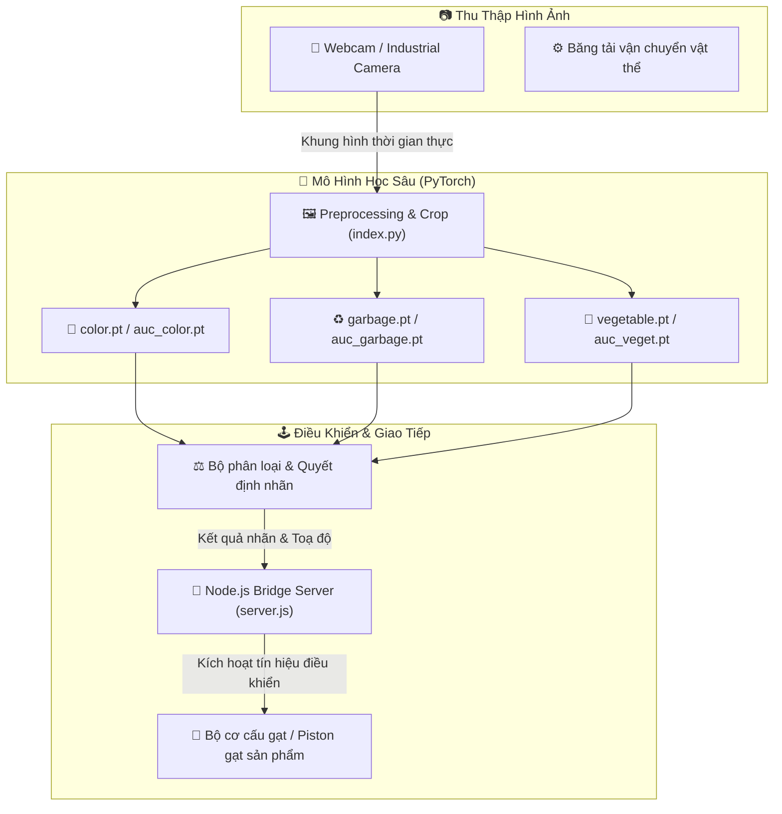

<div align="center">

# 🤖 SMART CONVEYOR BELT 🤖
### 📦 Deep Learning-Powered Industrial Object Sorting System
*Hệ thống Băng Chuyền Thông Minh Tự Động Phân Loại Sản Phẩm & Rác Thải Ứng Dụng Thị Giác Máy Tính*

[](https://python.org)
[](https://pytorch.org/)
[](https://opencv.org/)
[](https://nodejs.org/)
[](https://arduino.cc)

---

</div>

> [!IMPORTANT]
> **Smart Conveyor Belt** kết hợp thị giác máy tính và cơ cấu chấp hành công nghiệp. Khi vật thể di chuyển trên băng tải, camera ghi nhận khung hình, mô hình học sâu **PyTorch** nhận diện phân loại mục tiêu (màu sắc, loại rau củ, rác thải tái chế) và phát tín hiệu kích hoạt cánh gạt cơ học theo thời gian thực.

---

## 📑 Mục Lục (Table of Contents)
- [✨ Tính Năng Nổi Bật](#-tính-năng-nổi-bật)
- [🏗️ Kiến Trúc Hệ Thống](#️-kiến-trúc-hệ-thống)
- [📂 Cấu Trúc Dự Án](#-cấu-trúc-dự-án)
- [⚙️ Công Nghệ Sử Dụng](#️-công-nghệ-sử-dụng)
- [🚀 Hướng Dẫn Cài Đặt & Chạy Dự Án](#-hướng-dẫn-cài-đặt--chạy-dự-án)
- [🔮 Lộ Trình Phát Triển (Roadmap)](#-lộ-trình-phát-triển-roadmap)
- [📜 Giấy Phép (License)](#-giấy-phép-license)

---

## ✨ Tính Năng Nổi Bật

| Biểu Tượng | Tính Năng | Mô Tả Chi Tiết |
| :---: | :--- | :--- |
| 🎯 | **Phân Loại Đa Mục Tiêu** | Tích hợp sẵn 3 mô hình PyTorch chuyên biệt: phân loại màu sắc (`color.pt`), phân loại rác (`garbage.pt`) và rau củ quả (`vegetable.pt`). |
| ⚡ | **Inference Thời Gian Thực** | Tối ưu hóa pipeline xử lý khung hình camera đạt tốc độ cao, đáp ứng tốc độ trượt của băng chuyền. |
| 🎛️ | **Điều Khiển Cơ Cấu Chấp Hành** | Tự động phát xung tín hiệu tới servo / rơ-le / xi lanh khí nén để gạt vật thể vào từng ngăn riêng biệt. |
| 🌐 | **Giao Tiếp Máy Chủ Linh Hoạt** | Cầu nối Node.js (`server.js`) giúp giám sát số lượng vật thể đã phân loại theo thời gian thực qua Web. |

---

## 🏗️ Kiến Trúc Hệ Thống



---

## 📂 Cấu Trúc Dự Án

```bash
conveyor-belt-project/
├── 📄 index.py              # Script thu hình, tiền xử lý và chạy suy luận mô hình PyTorch
├── 📄 server.js             # Máy chủ điều khiển truyền thông giữa AI và cơ cấu chấp hành
├── 📄 package.json          # Danh mục dependencies Node.js
├── 📦 color.pt              # Trọng số mô hình phân loại màu sắc
├── 📦 auc_color.pt          # Mô hình tinh chỉnh màu sắc bổ trợ
├── 📦 garbage.pt            # Trọng số mô hình nhận diện phân loại rác thải
├── 📦 auc_garbage.pt        # Mô hình phân loại rác mở rộng
├── 📦 vegetable.pt          # Trọng số mô hình nhận diện rau củ nông sản
├── 📦 auc_veget.pt          # Mô hình nông sản nâng cao
├── 📂 src/                  # Mã nguồn tiện ích xử lý ảnh và kết nối phần cứng
└── 📂 test/                 # Kịch bản kiểm thử phân loại và đo lường độ chính xác
```

---

## ⚙️ Công Nghệ Sử Dụng

- **Deep Learning Framework**: PyTorch, Torchvision
- **Computer Vision**: OpenCV (cv2), NumPy, PIL
- **Backend & Network**: Node.js, Express, WebSocket / Socket.io
- **Hardware Controller**: Arduino / Raspberry Pi, Servo Motor, Conveyor belt mechanism

---

## 🚀 Hướng Dẫn Cài Đặt & Chạy Dự Án

```bash
# 1. Clone repository
git clone https://github.com/baolam/conveyor-belt-project.git
cd conveyor-belt-project

# 2. Cài đặt môi trường Python
python -m venv venv
# Active venv: .env\Scriptsctivate (Windows) hoặc source venv/bin/activate (Linux)
pip install torch torchvision opencv-python numpy

# 3. Cài đặt dependencies Node.js
npm install

# 4. Chạy server điều phối
node server.js

# 5. Khởi động module nhận diện qua camera
python index.py
```

---

## 🔮 Lộ Trình Phát Triển (Roadmap)

- [ ] 🚀 **YOLOv8 Edge Optimization**: Chuyển đổi mô hình sang định dạng TensorRT / ONNX để tăng FPS trên Raspberry Pi / Jetson Nano.
- [ ] 📈 **Production Statistics UI**: Bảng điều khiển thống kê năng suất phân loại (sản lượng/phút, tỷ lệ lỗi) theo ca làm việc.

---

<div align="center">

## 📜 Giấy Phép (License)

Dự án được phân phối dưới giấy phép **MIT License**.

---
**Made with ❤️ by [Bảo Lâm](https://github.com/baolam)**

</div>
